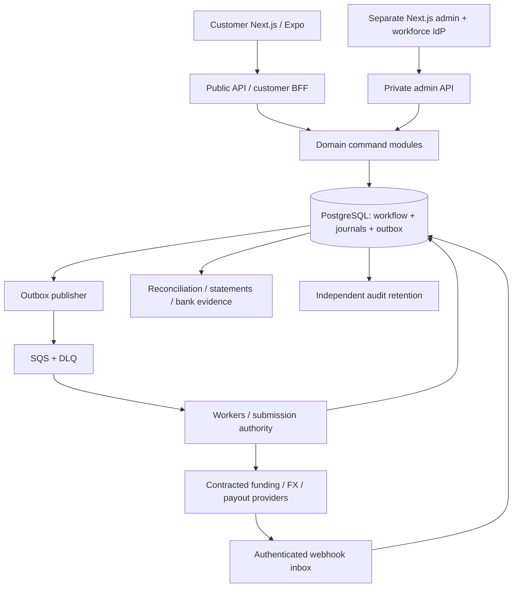

# A. Architecture

Baseline 2026-11-09. Read [source limitation and decisions](README.md). Regulatory/provider assertions are unverified pending owner/counsel.

## A1. One committed stack

Use TypeScript; Next.js App Router for `apps/customer-web` and independently deployed `apps/admin-web`; Expo development builds for iOS/Android in `apps/mobile`; NestJS with Fastify for `apps/api`; Node workers in `apps/workers`; PostgreSQL authoritative financial storage; SQS Standard with DLQs; Redis cache and abuse throttles; S3 encrypted documents and independent Object Lock audit archive; ECS Fargate and Terraform. Use `pg` parameterized SQL for transactional financial paths; do not hide posting locks in an ORM. OpenAPI 3.1 is the wire contract. Internal tRPC is removed so mobile, bank-facing integrations, and admin use the same versioned semantics.

A modular monolith owns financial commands. Separate deployables isolate web rendering, API, adapter execution, rate ingestion, and reporting load without requiring distributed transactions. PostgreSQL is the sole workflow and ledger authority. Queue delivery is at least once; exactly-once economic effect is constructed from durable identities, transactional guards, and provider reconciliation, never asserted from queue settings.

MySQL could implement many controls, but retaining it offers no compensating advantage for a sandbox with no production migrations or data obligations. PostgreSQL provides the chosen deferred constraints, transaction semantics, advisory locks, and security-definer posting boundary. Ledger engines are deferred until measured write contention merits their integration/reconciliation burden. Temporal is deferred: DB timers, leases, outbox, and explicit transitions cover current workflows; revisiting requires an ADR preserving journal atomicity and external-attempt identity.

## A2. Trust and funds boundaries

A financial instruction crosses a real external boundary only after committed authorization. No Next.js server action posts ledger lines or calls a financial provider directly. The BFF verifies sessions, forwards a scoped identity, and formats read projections. The API verifies identity again and owns domain authorization. Raw provider callbacks authenticate at a dedicated ingress; client redirects are never evidence of payment or verification.

The worked US entity book is an operational subledger for the regulated principal/funds owner. If Kita is a technology agent, the principal's assets/liabilities remain in that principal's book; Kita's service-fee statutory book is separate. Do not label controlled cash as Kita-owned before the signed legal funds-flow specifies ownership, beneficial interest, safeguarding eligibility, and agency responsibilities.

## A3. Repository and module boundaries

| Path | Responsibility / exported functions | Prohibited responsibility |
|---|---|---|
| `packages/contracts` | OpenAPI-derived DTOs, event schemas, errors, runtime validation | Database row export or provider secrets |
| `packages/money` | BigInt minor units, rational rates, checked rounding, formatting | Client authority to price accepted transfers |
| `packages/design-tokens`, `packages/ui-web` | Kita tokens and ported accessible primitives | Auth and financial side effects |
| `packages/api-client` | Typed transport, stable command keys, operation recovery | Automatic fresh-key retry |
| `packages/domain/identity` | `startVerification`, `applyIdentityEvidence`, `evaluateEligibility` | Trust capture completion as approval |
| `packages/domain/quotes` | `buildQuote`, `acceptQuote`, `priceFees`, `solveReceive` | Stale executable rates |
| `packages/domain/transfers` | `acceptTransfer`, `deriveCustomerStatus`, `applyEvidence` | Generic status patch |
| `packages/domain/ledger` | `postBusinessEvent`, typed posting templates, reversal policy | Arbitrary client-specified accounts |
| `packages/domain/funding`, `payouts`, `refunds` | Independent attempt state reducers | Network calls inside DB transaction |
| `packages/domain/treasury` | Liquidity reservation, exposure, FX positions, calendars | Counting expected inbound as spendable cash |
| `packages/domain/compliance` | Versioned rules, screening, holds, case workflow | Customer exposure of confidential investigations |
| `packages/domain/reconciliation` | Import, exact matching, break resolution | Editing original money history |
| `packages/domain/rewards`, `wallets` | Atomic reservations, vesting, redemptions | Reusing promotional points as fiat without policy |
| `packages/domain/admin` | Authorization, approval-bound commands, releases | Privileged bypass of legal prohibitions |
| `packages/providers/<vendor>` | Provider transport and evidence mapping | Deciding customer refunds or accounting policy |
| `apps/workers` | Inbox/outbox, timers, provider dispatch, recovery, reports | In-memory-only job schedules |
| `infra/terraform`, `tests` | Deployment, controls, verification evidence | Production credentials or raw PII fixtures |

Dependencies flow client→contracts and API→domain→database/provider ports. Providers implement ports; domains do not import a concrete provider. CI boundary rules prevent UI imports of server modules and cross-domain table writes. Single SQL transaction may call several domain command handlers under one transaction context.

## A4. State authority

Maintain separate funding, compliance, FX, payout, refund, dispute, and reconciliation records. Holds are additive rows with scopes `funding`, `fx`, `payout`, `refund`, `withdrawal`, or `all`. Clearing one does not clear another. Customer status is derived: action-needed → under review → awaiting funding → processing → delivered; refund/return/dispute are separate badges and timelines. Preserve delivered history after an ACH return.

`provider_attempts` has stable operation reference, immutable request hash, lease/fencing generation, evidence, and allowed transitions. A partial unique index allows only one unresolved payout authority per operation, including PAID until a documented return resolves its liability. An unknown payout blocks retry through a new provider. Durable timer rows drive inquiries, deadlines, reward vesting, and case escalation. Workers always reread current state; old messages convey work identity, not perpetual payment permission.

## A5. Country and product configuration

Configure origin sets US/USD, CA/CAD, UK/GBP, EU/EEA by individual country/EUR and other explicitly approved currencies, JP/JPY, SG/SGD, AU/AUD; destination PH/PHP. EUR and EEA are not country codes. `GB` is the ISO country code used for UK. For every combination store licensed entity, residence/state eligibility, service, currencies, methods, limits, disclosures, languages, taxes, holidays, funding rules, provider capabilities, and effective dates. Default every capability to disabled until DEP-01…DEP-10 evidence applies. US→PH is the worked and first activation corridor, not blanket US state authorization.

Initial real scope: personal C2C remittance, approved ACH, bank deposit and one contracted GCash route; debit Express may activate once DEP-03 passes. Maya, cash pickup, bills, wallet, rewards, auto-conversion, scheduled transfers, stablecoin treasury, KYB, and batch payout have complete extension contracts and tests but separate activation gates. Source-derived later features are not silently removed.

## A6. Software baseline and release pinning

Public documentation checked 2026-11-09: [Node 24.22.2 LTS](https://nodejs.org/en/blog/release/v24.22.2), [Next.js blog and security releases](https://nextjs.org/blog), [PostgreSQL supported versions](https://www.postgresql.org/support/versioning/), [Expo SDK 58](https://expo.dev/changelog/sdk-58). Select Node **24.22.2**, PostgreSQL **18.6**, Next.js **16.4.5**, Expo **58 / React Native 0.88**. Next16.4.5 is the patched baseline from the [November security release](https://nextjs.org/blog/november-2026-security-release). Exact React/Expo patches must match that security baseline and native payment/IDV SDK compatibility before the lockfile is accepted. This is a named build gate, not permission to use an unpatched initial release. The evidence register records verified exact pins after checking that advisory. Do not call the plan's development host Node version the target version.

Keep Tailwind **3.4.19**, TypeScript **5.9.3**, Zod **4.3.5**, TanStack Query **5.90.16**, React Hook Form **7.70.0** as inspected porting baselines, subject to security/compatibility lock review. Pin exact resolved versions with integrity hashes, never ranges in the shipped manifest. Expo controls its React peer dependency independently of web. Workspaces must not force one incompatible React instance. Pin web React/ReactDOM **19.3.1** ([official release](https://github.com/react/react/releases)), NestJS **12.4.1** ([official release](https://github.com/nestjs/nest/releases)), Fastify **5.12.8** ([official release](https://github.com/fastify/fastify/releases)) and pg **8.23.0** ([official changelog](https://github.com/brianc/node-postgres/blob/master/CHANGELOG.md)) as the planning baseline checked2026-11-09. The pg changelog does not list every patch; lock review must check package advisories and resolved patches. Expo source reports **58.0.19** ([package source](https://github.com/expo/expo/blob/main/packages/expo/package.json)); this is a candidate exact pin until its published package/native SDK compatibility is proven. Managed Redis engine/patch and infrastructure-provider locks are recorded by KITA-PLAT-01 before deployment. Release cannot pass with unresolved or unpatched pins; security updates require an explicit reviewed lock change.

## A7. Scale, failure, and acceptance boundaries

Design target: 100 command requests/s, 20 transfer acceptances/s, 200 reads/s, 2,000 concurrent tracking clients; test 3× bursts. Command SLO 99.9% monthly excluding explicit dependency-unavailable business responses; local p95 reads 300 ms, local financial commit 750 ms, quote end-to-end 2 s if upstream meets contract; inbox durable acknowledgment p95 500 ms or stricter provider limit. These are engineering targets, not measured claims.

Start with unpartitioned financial tables to retain global uniqueness/FKs; partition only after measured table growth, with a migration proving dedup and immutable references. Reporting uses replicas/warehouse, never authorizes funds. Split services when ownership or failure isolation warrants it, not at an arbitrary transaction count. No active-active financial writers. See K for fenced recovery and L for evidence required before real-money activation.
